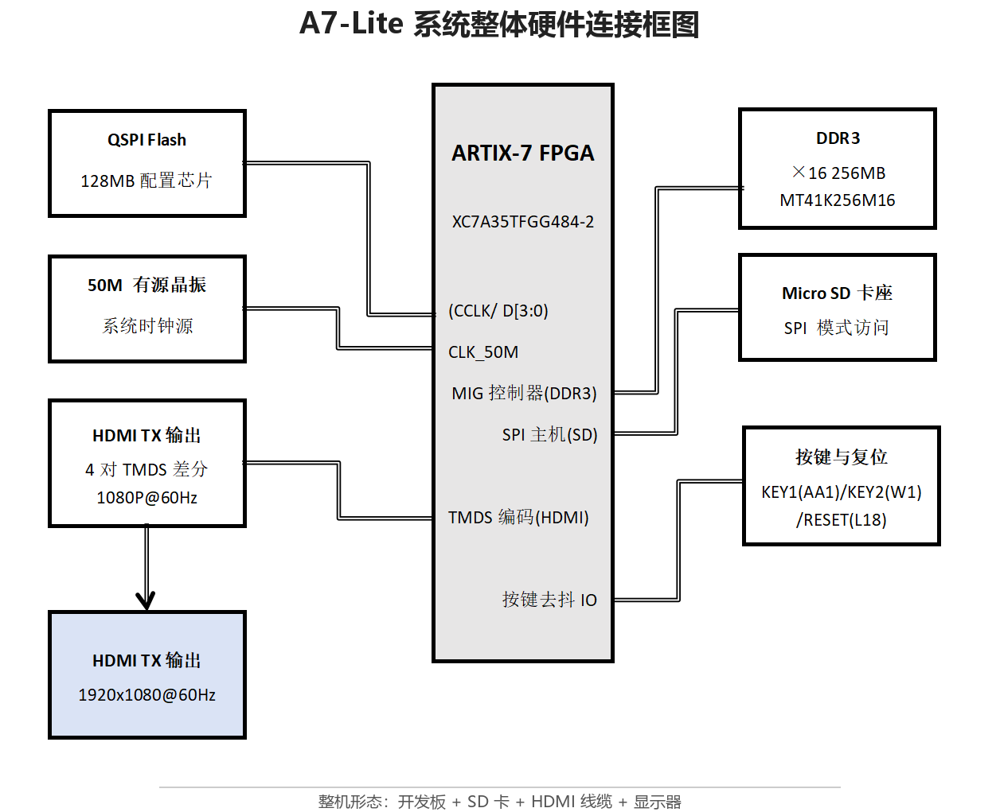

# 设计报告 — sd_bmp_video320

## 1. 选题背景与创新点

### 1.1 背景

题目来自一块 A7 Lite（xc7a35tfgg484-2）FPGA 开发板：以 SD 卡、DDR3、HDMI 和三个按键构成完整的媒体播放链路。  
目标是做一个**纯硬件、免操作系统**的图片/视频播放器：

- 从 SD 卡读取 1080p BMP；
- 从 SD 卡读取 320×240 RGB565 小视频；
- 通过 DDR3 双缓冲输出 1080p60 HDMI；
- 用 OSD 菜单完成图片切换、模式切换、视频切换。

它解决的实际问题：**在低成本 FPGA 上不依赖操作系统与处理器软件，把“SD 卡里的媒体”稳定地播放到 1080p 显示器，并能在播放过程中实时切换与处理。**

### 1.2 前人与本项目基础

桌面旧版本（详见 `data/version_history.md`）：

- `A7lite_v1_work`：SD 读取链；
- `newdemo1018`：显示/OSD 链；
- `demo-only-1080p`：图片-only 合并版；
- `sd_bmp_hdmi_v2_video`：早期视频-only 版本；
- `sd_bmp_video320`：本项目的直接基础。

本项目在这些版本上做了三类推进：

1. **视频 15fps 稳定化**：CMD18 多块读 + 25MHz + 4-VSYNC 节流；
2. **媒体切换正确性**：偏移修复、FIFO flush、`img_trans` 复位、`vid_next_ack`；
3. **图像模式加深**：图片索引表、中值 3×3、Canny 近似。

### 1.3 创新点

- 用 **CMD18 一次读 300 块**替代 300 次 CMD17，消除逐扇区命令开销；
- 用 **25MHz SPI 主动“限速”**匹配 1080p 生成消耗，避免 4 行缓冲被冲垮；
- 用 **4-VSYNC 节流**把自由跑的播放器锁定到 15fps；
- 用 **FIFO flush + `vid_next_ack`** 解决媒体切换/视频下一段的整块偏移；
- 用 **100MB 图片索引表**解决最后一张→第一张的长扫描；
- 在 1080p 像素流中实现 **精确 3×3 中值**与 **Canny 近似**。

---

## 2. 设计原理与功能框图

### 2.1 总体框图



*图 2-1 系统总体架构与硬件连接（读取域 → 帧缓存域 → 显示域，含按键与 HDMI 输出）*

### 2.2 数据流

- **图片**：SD → `rd_bmp` 找 `BM` + 1920×1080 → 24bit BMP 转 16bit → `ddr3_rx_buffer` → DDR3；
- **视频**：SD → `vid_player` 读 DV1 头/帧 → 16bit RGB565 → 4 行行缓冲 → 1920×1080（顶/底黑边 + 3× 放大）→ DDR3；
- **显示**：DDR3 → `ddr3_tx_buffer` 行缓冲 + `img_scaler` → `img_trans` 过渡 → `img_process` 17 模式 + OSD → HDMI。

### 2.3 时钟域

| 时钟 | 频率 | 用途 |
|---|---:|---|
| `clk` | 50MHz | SD 控制、按键、视频/图片读、DDR3 写侧像素 |
| `ui_clk` | 100MHz | DDR3 MIG 用户接口、写 FIFO 读、写地址 |
| `clk_out1` | 148.5MHz | HDMI 像素、OSD、图像处理、DDR3 读侧 |
| `clk_5x` | 742.5MHz | OSERDES 5× 串行时钟 |

CDC 关键点：

- `vsync` 148.5M → 50M：两级同步 + 上升沿；
- `frame_sync` 50M → 100M：toggle 同步，用于清 h/v + flush FIFO；
- `media_sel` 50M → 148.5M：`img_trans` 内 2FF，媒体切换清过渡；
- 所有同步器入口在 `top_pin.xdc` 加 `false_path`。

---

## 3. 软硬件划分依据与接口

### 3.1 划分

本项目为**纯 PL（RTL）实现**，不依赖 PS 处理器与操作系统：

- SD 协议、DDR3 控制、HDMI 时序、OSD、图像算法全部 RTL；
- 原因：
  - 实时像素流对确定性要求高；
  - 免操作系统/驱动，上电即用；
  - 资源/时序可预测；
  - 复现只需标准 Vivado 综合实现流程。

### 3.2 主要接口

| 接口 | 方向 | 说明 |
|---|---|---|
| `sd_clk/sd_cmd/sd_dat0/sd_dat3` | SD | SPI 模式；视频 25MHz，图片/探测 50MHz |
| `ddr3_*` | DDR3 | MIG 用户接口，128bit 写/读 |
| `hdmi_tx_*` | HDMI | TMDS 差分，1080p60 |
| `key_in/key_in2` | 输入 | 去抖后菜单 |
| `find_led` | 输出 | 扫描/找到指示 |

### 3.3 关键模块

| 模块 | 职责 |
|---|---|
| `sd_ctrl`/`sd_rd` | SPI 初始化、CMD17/CMD18、CRC、25/50MHz 时钟使能 |
| `rd_bmp` | 逐扇区找 BMP、读 24bit、图片索引表 |
| `vid_player` | DV1 探测、CMD18 整帧、行缓冲、1080p 生成、4-VSYNC 节流 |
| `ddr3_rx_buffer` | 16→128bit 打包、双缓冲地址、FIFO flush |
| `ddr3_tx_buffer`/`img_scaler` | DDR3 读、行缓冲、缩放、`rd_off` |
| `img_trans` | 8 种过渡、`rd_off`、媒体切换复位 |
| `img_process` | 17 种模式、OSD、中值/Canny |
| `key_menu` | 5 行菜单、媒体/图片/视频/模式/颜色/效果 |

---

## 4. 优化过程与性能/资源对比

### 4.1 视频 12fps → 15fps

**现象**：目标 15fps，OSD 实测 12fps。

**分析**：

- 1080p 生成 2,073,600 像素 / 50MHz = **41.47ms**；
- 帧数据 153,600B，300 个扇区；
- 原实现每扇区一次 CMD17，300 次命令/卡片访问；
- 60Hz VSYNC 只能 60/N：15fps=4 分频 66.67ms，12fps=5 分频 83.33ms；
- 原实现每帧超过 66.67ms，落到 5 分频。

**优化**：

1. `sd_rd` 增加 CMD18 多块读 + CMD12；
2. 视频 25MHz SPI（3.125MB/s），300 块约 49.2ms；
3. `vid_player` 每帧一次 CMD18，4-VSYNC 节流；
4. FIFO/行缓冲配合，避免读快于生成。

**结果**：仿真 66.668ms/帧，OSD=15。

### 4.2 偏移 bug

**现象**：视频下一段后回图片，图片整块右移。

**根因**：

- `frame_sync` 只清 h/v，未清 DDR3 写 FIFO；
- FIFO 残留视频像素从 h=0 写，图片从 h=N 开始；
- `img_trans` 的 `rd_off` 未在媒体切换时清零；
- 顶层用原始 `vid_next` 触发 `frame_sync`，而 `vid_player` 在读帧时忽略该键，导致当前视频被中途清 h/v。

**优化**：

- `ddr3_rx_buffer`：`frame_sync` 后 flush FIFO 31 个 ui_clk；
- `img_trans`：媒体切换清 `state/rd_off/swap_allow/first_done`；
- `vid_player`：新增 `vid_next_ack`，只有真正接受才让顶层 `frame_sync`；
- `top_pin.xdc`：`u_img_trans/media_s1` CDC false path。

### 4.3 图片最后一张→第一张

**根因**：`rd_bmp` 从当前图片末尾一直扫到 `STOP_ADDR=100MB` 才回绕。

**优化**：图片索引表版本，上电扫前 100MB，记录 16 个 BMP 头扇区；下一张直接跳表。

**代价**：上电 catalog 约 17s；切媒体仍会重新 catalog（未做 4 缓冲）。

### 4.4 中值/Canny

- 中值：3×3 灰度，19 比较器精确中值网络；边界回退灰度；
- Canny：Sobel 幅值 + 双阈值（强白/弱灰/黑底）；
- **限制**：当前 Canny 没有 NMS/完整滞后阈值，是近似版。

### 4.5 资源/时序对比

| 版本 | fps | LUT | FF | BRAM | WNS | WHS |
|---|---:|---:|---:|---:|---:|---:|
| 15fps 前（12fps） | 12 | 9,670 | 6,842 | 9.5 | +0.365 | +0.016 |
| 15fps 版 | 15 | 9,697 | 6,855 | 9.5 | +0.230 | +0.048 |
| + 偏移修复 | 15 | 约 9,712 | 约 6,862 | 9.5 | +0.342 | +0.035 |
| + 索引表 | 15 | 9,909 | 7,419 | 9.5 | +0.307 | +0.050 |
| + 中值/Canny（最终） | 15 | **10,382** | **7,524** | 9.5 | **+0.134** | **+0.029** |

> 最终：LUT 49.91%，FF 18.09%，BRAM 19%，DSP 3/90；WPWS −0.245ns 为 OSERDES 固有。

---

## 5. 大模型协作记录

### 5.1 工作流

```text
现象/需求
→ 让模型先读 RTL/报告，不急着改
→ 计算帧预算/带宽/资源
→ 提出可验证假设
→ 写/改 testbench 或 ILA 方案
→ 本地 xsim 验证
→ Vivado 综合/实现
→ 看 WNS/WHS/资源
→ 失败则回退/修正
```

### 5.2 关键提示词（摘要）

1. **12fps 根因**
   > “视频 OSD 目标 15fps 实际 12fps。先不要改代码，按 1080p 生成时间、SD 每帧字节数、VSYNC 分频、CMD17/CMD18 开销列出时间预算，指出最可能瓶颈和验证方法。”

   模型回答：12=60/5；生成 41.47ms；SD 300 次 CMD17；建议 CMD18 + 25MHz + 4-VSYNC。

2. **偏移 bug**
   > “视频下一段后切回图片整块右移。检查 media_sel/frame_sync/FIFO/rd_off/img_trans，按‘哪个信号在切换时没清’列候选，并给出 ILA 判读。”

   模型回答：FIFO 未 flush、`rd_off` 未清、`vid_next` 与 `frame_sync` 节拍不一致；提出 `vid_next_ack`。

3. **索引表只扫到 2 张**
   > “offsetfix 能扫全部，index 版只 2 张。检查 CATALOG_END、STOP_ADDR、img_total/img_sec 写入条件。”

   模型回答：32MB 截断；改 100MB。

4. **CDC 时序**
   > “加 img_trans media_sel 后 WNS=-4.7ns，报告第一条违例路径。”

   模型回答：`media_sel` 50M→148.5M 同步器被当同步路径；加 false_path。

### 5.3 自我纠错轨迹

- 最初用简化 SD 模型仿真得到 10fps，模型没有直接断言“板上就是 10”，而是解释：仿真模型略慢，实际 12 说明刚好吃到第 5 个 VSYNC；后续用 25MHz 模型得到 15fps。
- 索引表最初只设 32MB，实测只能 2 张；模型根据“offsetfix 能扫全部”反推是范围截断，改成 100MB。
- Canny 最初实现为双阈值，模型明确标注“近似”，没有把它说成完整 Canny。

### 5.4 智能体工作流设计

- 读代码 → 建模 → 仿真 → 实现 → 报告，五步循环；
- 每次修改只动一个子系统，保留旧 bit/备份；
- 失败时用 `report_impl_timing.rpt` 的第一条违例反推，而不是猜；
- 所有结论落到 `README.md` / `DESIGN_REPORT.md`，下次会话可继续。

---

## 6. 技能包的提炼过程

技能包在 `skill/`，详细说明见 `skill/README.md`。提炼来源：

| 失败/观察 | 提炼出的技能 |
|---|---|
| 12fps 被误认为“计数器错” | 先做 VSYNC 分频/帧预算，再怀疑计数器 |
| CMD17 300 次导致慢 | CMD18 + 块数 + FIFO/限速 |
| 4 行缓冲被 4-bit/50MHz 冲垮 | 带宽匹配与弹性缓冲 |
| 切媒体图片右移 | FIFO flush + `img_trans` 复位 + 源切换 ack |
| WNS -4.7ns | CDC 同步器必须 false_path |
| 索引表只 2 张 | catalog 范围必须覆盖完整扫描上限 |
| `ram_style="block"` 无效 | 行缓冲推断失败要查读口/多阵列结构 |

每个技能条目在 `skill/README.md` 写明：适用范围、使用方法、失效条件、验证效果、来源失败。

### 6.1 技能包构成

技能包以队友定稿的 `skill/ai-pack/` 为主体（含技能入口 `SKILL.md`），另保留 PYNQ 加分模板 `pynq_generic/`：

| 赛方要求 | 技能包位置 | 内容 |
|---|---|---|
| 提示词工作流 | `skill/ai-pack/references/prompt-library.md` | 10 条提问模板（中/英双语），每条含"什么时候用 / 怎么问 / 答完怎么验"；配套 `symptom-playbook.md` 症状路由 |
| 案例模板 | `skill/ai-pack/assets/` | TB（`tb_template.v`，带 watchdog/单调性断言/结构化 RESULT）、仿真（`run_xsim.ps1` 三段日志）、构建（`build_run_flow.tcl`，run 流程保留 IP XDC）、报告（`report_template.md` 7 节含失效条件）4 个模板 |
| 校验脚本 | `skill/ai-pack/scripts/` | G1~G5 五道判定门脚本，退出码统一 0/1/2（见 6.2） |
| 踩坑清单 | `skill/ai-pack/references/pitfalls.md` | 28 条（P01–P28），按语言声明/验证方法/设计集成/存储素材/环境流程五组分类，每条含触发条件、现象、根因、排查步骤、对策 |

技能入口 `skill/ai-pack/SKILL.md`（`name: fpga-bringup-debug`）沉淀了本项目调试的完整方法论：**S0 基线 → S1 预算 → S2 假设 → S3 实验 → S4 修复 → S5 沉淀**主循环、十条硬规则、症状路由表与五道判定门。

### 6.2 五道判定门在本仓库真实产物上的验证

| 门 | 判据 | 本仓库实测结果 |
|---|---|---|
| G1 静态门 | 无常量截断 / 无恒值占位 / 无未用输入 | 扫 `src/rtl/` 27 文件：命中 1 处恒 0 占位（`new/key_menu.v:70` `key1_long`，已记录为待办项），其余干净 |
| G2 仿真门 | 结构化 RESULT，FAIL/ERROR=0 | `sim/results/` 3 份日志全 PASS：`swaps=17 fps=15`、CMD18 多块 2048B、CMD17 单块 512B |
| G3 时序门 | WNS ≥ 0 且 WHS ≥ 0 | WNS **+0.134ns** / WHS **+0.029ns**；WPWS −0.245ns 为 OSERDES 固有相位（9 端点，已知项，不参与判定） |
| G4 资源门 | 资源占用在预算内 | LUT **49.91%** / FF **18.09%** / BRAM **19.00%** / DSP **3.33%** |
| G5 交付门 | 原件哈希未变、清单一致 | `data/checksums.sha256` 已随定稿重新生成并复核通过 |

技能包按可复用性标准交付：每个条目均写明适用场景、使用方法、失效条件与验证效果；四个真实调试案例（12→15fps、整块偏移、CDC −4.7ns、索引截断）记录在 `skill/ai-pack/examples/case-video320.md`。

---

## 7. 复现说明

### 7.1 环境

- Vivado 2022.2；
- xc7a35tfgg484-2；
- Windows 10/11；
- Python 3（生成测试视频）。

### 7.2 构建

```bat
cd sd_bmp_video320_submission
D:\Xilinx\Vivado\2022.2\bin\vivado.bat -mode batch -source build\build.tcl
```

### 7.3 仿真

```powershell
powershell -ExecutionPolicy Bypass -File sim\run_sim.ps1
```

### 7.4 上板

1. 用 `data/testvideo/gen_dv1.py` 生成 DV1；
2. 从扇区 0 裸写 SD；
3. 烧 `board/bitstreams/sd_rd_img_median_canny.bit`；
4. 按 `board/board_test_log.md` 测试；
5. 记录 OSD 帧率、切换时间、偏移、模式效果。

#### 7.4.1 上板实测结果（`board/board_test_log.md`）

| 编号 | 测试项 | 实测结果 |
|---|---|---|
| T1 | 上电显示 SD 中 BMP 与 OSD 参数行 | 通过 |
| T2 | KEY2 切换至 15 中值模式 | 去噪正常、边缘保留，通过 |
| T3 | KEY2 切换至 16 Canny 模式 | 白/灰双阈值轮廓显示正常，通过 |
| T4 | 切换视频播放 | OSD 显示 15FPS，画面连续，通过 |
| T5 | 连续按"视频 下一段"5 次 | 无右/上移，段切换正常，通过 |
| T6 | 视频 → 图片 | 切回图片不偏移，切换正常，通过 |
| T7 | 图片最后一张 → 第一张 | 索引版直接跳转，无长扫描，通过 |
| T8 | 切媒体 → 回图片（索引版重新 catalog） | 重新 catalog 后正常，耗时约 17s，通过 |
| T9 | 连续播放 10 分钟 | 无死机、花屏与卡顿，通过 |

修复前观察项（B0-1 帧率 12fps、B0-2 图片右移、B0-3 末图→首图长扫描）在本次提交中均已解决并上板确认。

### 7.5 预期

- 视频 OSD 15fps；
- 图片 17 模式可切；
- 中值去噪、Canny 双阈值轮廓；
- 视频下一段/媒体切换不再出现整块右/上移（按 `vid_next_ack` 修复）；
- 索引版最后一张→第一张直接跳表，但上电/切媒体有 catalog 时间。

上述预期均已按 §7.4.1 在实板上逐项验证通过（T1–T9），修复前的 12fps/图片右移/末图长扫描三类现场观察（`board/board_test_log.md` B0-1~B0-4）全部消除。

---

## 8. 已知限制与后续

1. Canny 近似，无 NMS/滞后；
2. 媒体切换仍重读，索引表会被复位；
3. 索引 catalog 100MB 约 17s；
4. 视频读帧途中“下一段”可能被忽略；
5. 4 行缓冲抗 SD 抖动有限，建议后续 16KB FIFO / 源帧双缓冲；
6. 未做 AI 场景识别（已评估：64×64 分类约 3～5 周）。

---

## 9. 结论

本项目在 xc7a35t 上完成了：

- 1080p 图片/视频播放；
- 15fps 稳定视频；
- 17 种图像模式（含中值/Canny 近似）；
- 媒体切换偏移修复；
- 图片索引表；
- 可复现的 RTL、仿真、构建、上板脚本。

资源 49.91% LUT、18.09% FF、19% BRAM，时序 WNS +0.134ns，仍有后续优化空间。
